# Sýnidæmi 5

## Farsími - Mobile

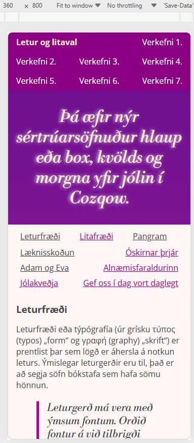 &nbsp; 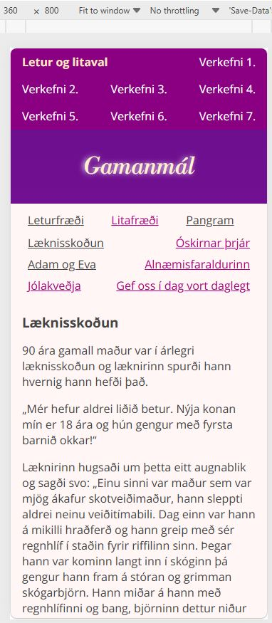

## Spjaldtölva - Tablet

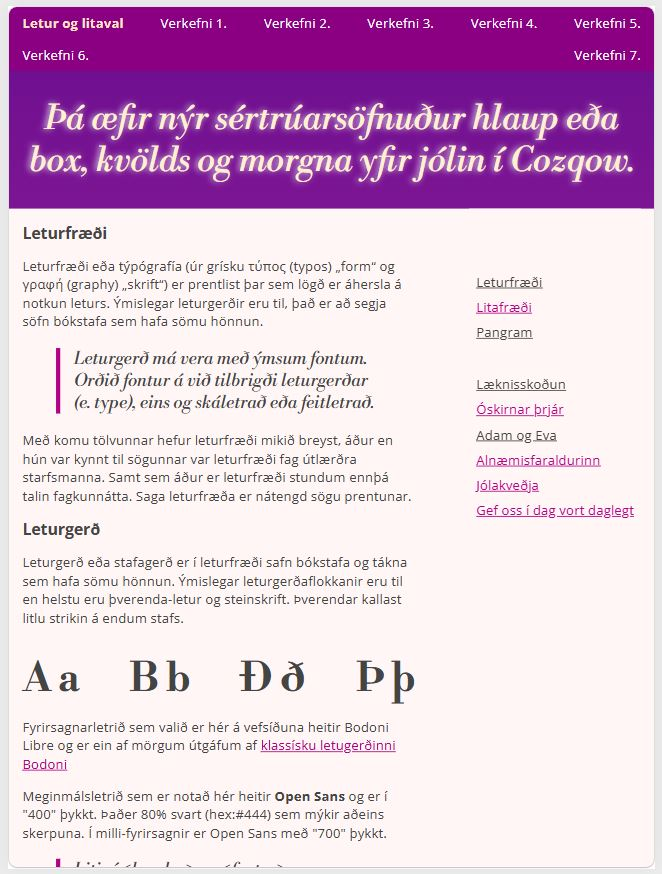

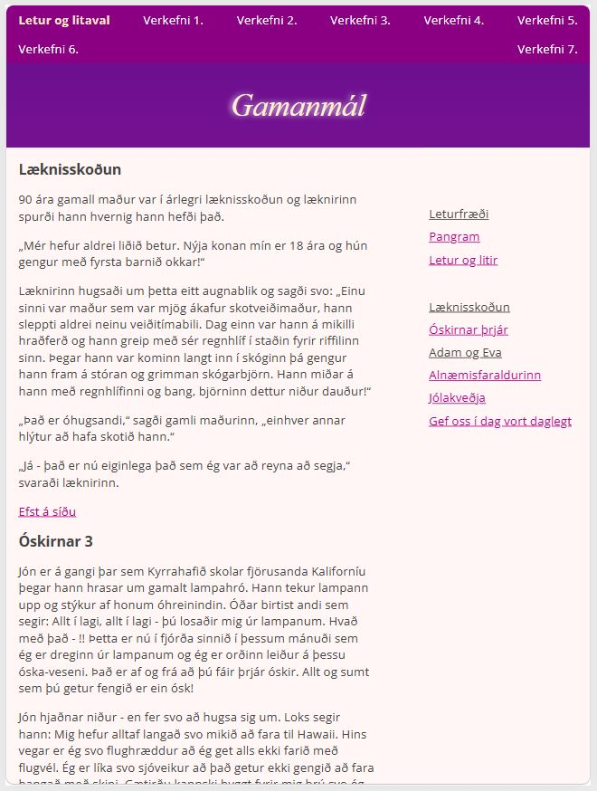

## Fartölva - Laptop

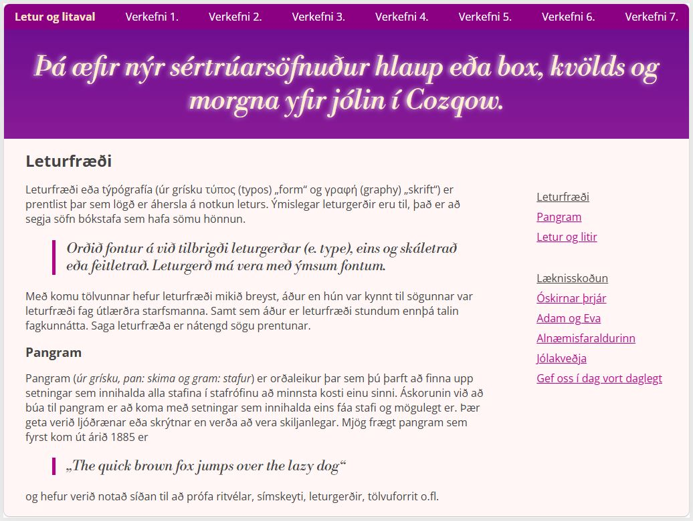

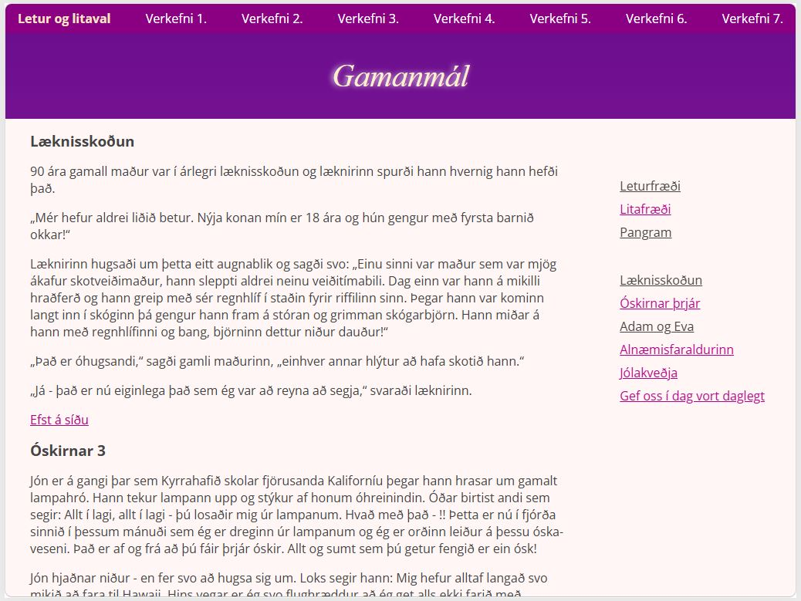

## Efnisyfirlit - Mobile

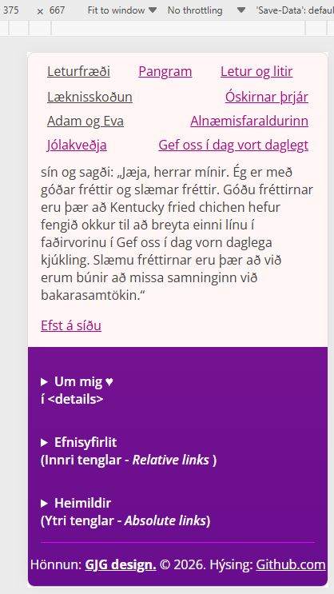 

## Efnisyfirlit - Tablet

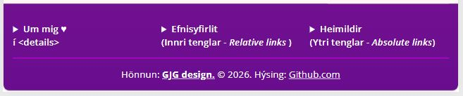 

í `footer` er `details` tagið. þegar smelt er á eitt af þeim, birtast eftirfarandi upplýsingar.

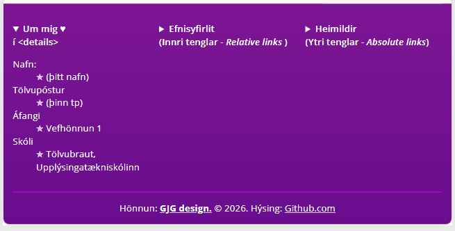 

Upplýsingar í _"Description list"_

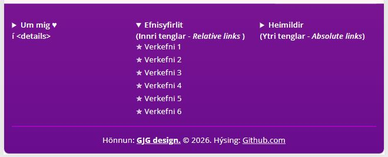 

Athugið að tenglar eru með öðru sniði en í megindálk `main`

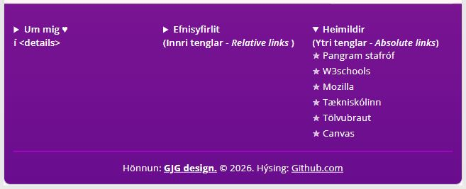 

Athugið að **aðeins eitt val** er opið í einu.

## Stór skjár - Desktop

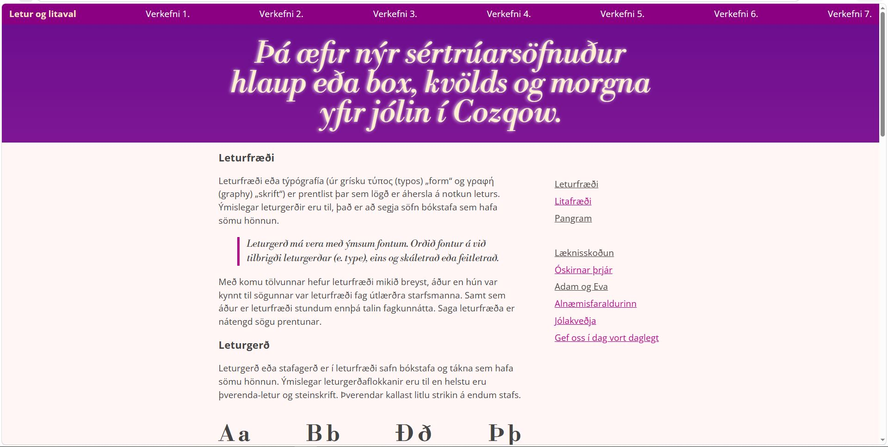 

> Athugið að hafa `max-width: 960px` og `margin:auto` á "container" í stærri skjáum

